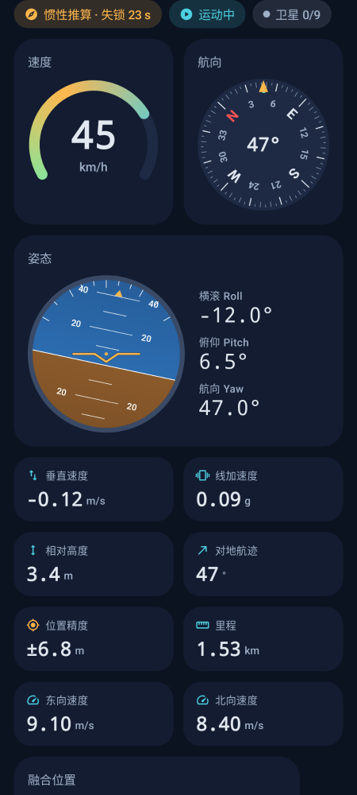
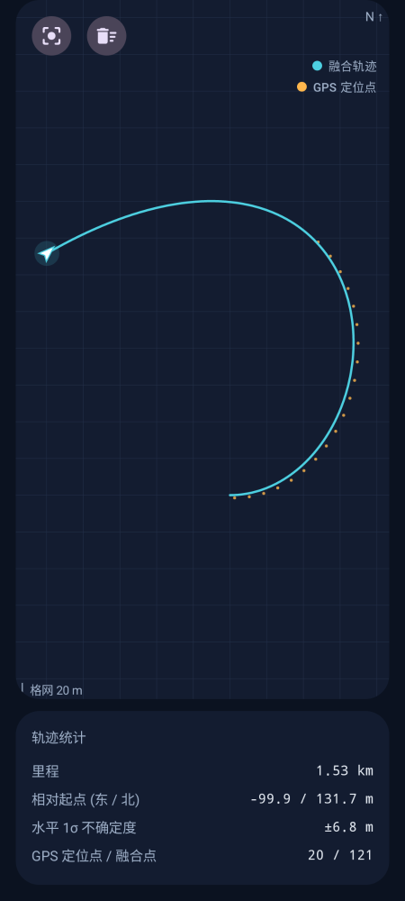
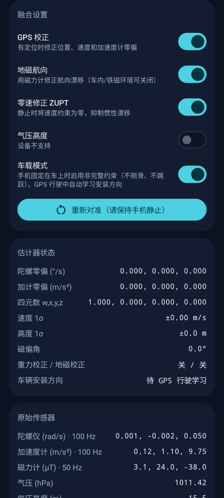

# 惯导姿态 ImuNav

Android 应用（Kotlin + Jetpack Compose / Material 3）：仅凭手机 IMU 在 **无 GPS** 时推算姿态、速度与位置，**有 GPS** 时自动融合校正。

| 仪表 | 轨迹 | 传感器 / 设置 |
|---|---|---|
|  |  |  |

## 功能
- **姿态**：横滚 / 俯仰 / 航向、四元数，人工地平仪 + 罗盘（含对地航迹标记）
- **运动**：水平速度、垂直速度、ENU 三轴速度、去重力线加速度、里程、相对高度
- **位置**：融合经纬度、1σ 不确定度、融合轨迹与 GPS 点对比（可缩放/拖动）
- **状态**：GPS 融合 / 纯惯性推算（显示失锁秒数）、静止检测、卫星数
- **可调**：GPS 校正、地磁航向、零速修正、气压高度、车载模式；一键重新对准

## 算法（`fusion/` 纯 Kotlin 模块，含单元测试）

| 组件 | 作用 |
|---|---|
| `AttitudeFilter` | Mahony 互补滤波（SO(3) 四元数），陀螺全速率积分 + 在线零偏估计；重力修正俯仰/横滚（偏离 1 g、转弯或运动时自动降权），磁力计只修正航向且有磁干扰门限；GPS 提供磁偏角转真北 |
| `InsKalmanFilter` | 9 状态卡尔曼滤波：ENU 位置、速度、加速度计零偏；捷联积分预测，标量序贯更新 + 卡方门限剔除野值 |
| `MotionDetector` | 加速度方差 + 角速度阈值判断静止 → **ZUPT 零速修正**，抑制无 GPS 时的漂移 |
| `FusionEngine` | 传感器调度：GPS 位置/速度更新、气压高度更新（GPS 慢速标定气压基准）、GPS 速度差分补偿线加速度以保持水平基准、车载模式非完整约束（行驶中自动学习手机安装方向） |

**无 GPS**：姿态长期稳定（重力 + 地磁闭环）；速度/位置为惯性推算，静止时 ZUPT 归零，车载模式下约束侧向/垂向速度。注意：手机 MEMS 纯惯导位置误差随时间增长（典型数十秒级可用），这是物理限制。
**有 GPS**：位置、速度被校正，加速度计零偏、气压基准、磁偏角同时被标定，失锁后推算精度明显提升。

坐标系：机体系为 Android 传感器坐标（x 右、y 屏幕上方、z 屏幕外），导航系 ENU。航向 = 手机顶部指向，北起顺时针。

## 构建
```bash
cd ImuNav
./gradlew :fusion:test          # 融合算法单元测试
./gradlew assembleDebug         # app/build/outputs/apk/debug/app-debug.apk
./gradlew :app:recordPaparazziDebug   # 重新生成界面截图
```
GitHub Actions（`.github/workflows/imunav-android.yml`）会自动测试并产出 APK 构件。
要求：minSdk 26（Android 8.0），需要陀螺仪和加速度计。
