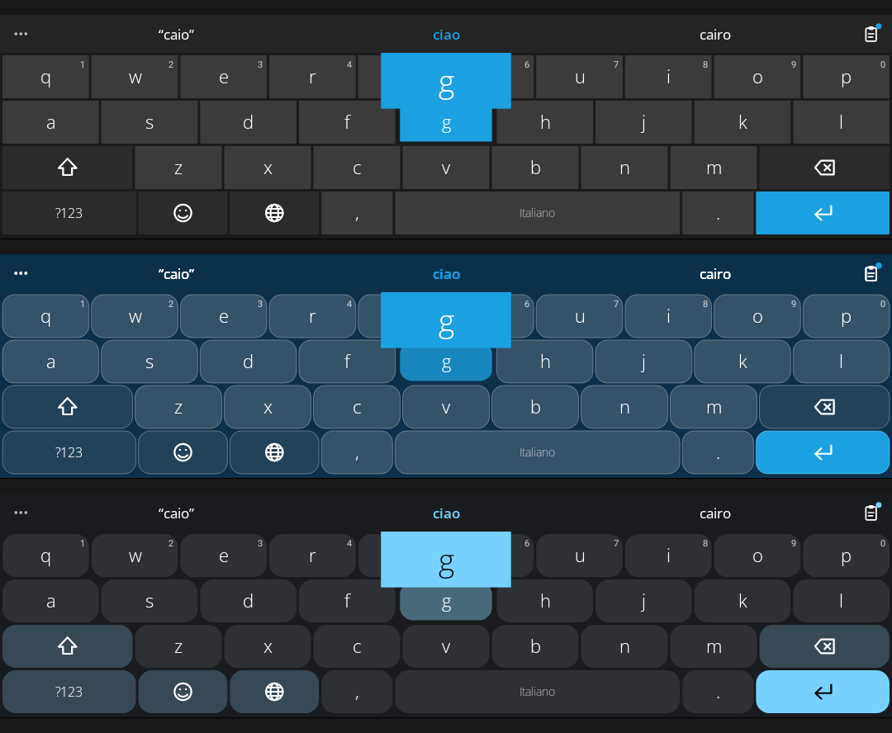

<h1 align="center">MetroWin Keyboard</h1>

<p align="center">
  <b>La tastiera di Windows Phone su Android.</b><br>
  Tasti Metro piatti, caratteri grandi e leggeri, scrittura a scorrimento, traduzione, GIF, appunti, digitazione vocale.<br>
  Software libero. Nessuna pubblicità, nessuna analisi, nessun tracker: ciò che scrivi resta sul tuo telefono.
</p>

<p align="center"><a href="README.md">English</a> · <b>Italiano</b></p>

<p align="center"></p>

Pensata per funzionare insieme a [MetroWin Launcher](https://github.com/developerkenshi-coder/MetroWinLauncher): stessi tre aspetti, stessi 20 colori, e non intralcia nella casella di ricerca del launcher. Funziona bene anche con qualsiasi altro launcher.

## Installazione

1. Scarica l'APK dall'[ultima release](../../releases/latest) e aprilo (consenti al browser o al gestore file di installare app sconosciute).
2. Apri **MetroWin Keyboard**. Una guida all'attivazione accende la tastiera e la seleziona, accorgendosi da sola di quando ogni passaggio è fatto.
3. Il tutorial è nell'app e dentro la tastiera (i tre puntini, poi **?**).

Android 8.0 (API 26) o successivo.

## Funzioni

**Scrittura**
- Scrittura a scorrimento, tocco prolungato per accenti, cifre e simboli (durata in ms, 200 di default), doppio spazio per il punto, maiuscole automatiche, scorrimento sulla barra spaziatrice per muovere il cursore.
- Anteprima a colori del tasto che premi, come su Windows Phone.
- Correzione che **Backspace annulla**, accenti, completamento, previsione della parola successiva e della frase, parole offensive bloccate (più la tua lista).
- Impara da te, **solo sul telefono**; mai nei campi password; esportabile e cancellabile.

**Strumenti**, a un tocco dalla barra: i tre puntini aprono la cassetta degli strumenti e il **tasto rapido** porta dritto agli appunti (o a qualsiasi strumento scelto), con un puntino quando hai copiato qualcosa.
- **Appunti** con limite a scelta, elementi fissati e **immagini**.
- **Traduci** il campo, o ciò che hai appena copiato (utile per i messaggi ricevuti), tra 40 lingue. Di default Google; si possono scegliere Google Cloud, DeepL, LibreTranslate o MyMemory.
- **GIF** da una fonte a scelta: GIPHY, Tenor (con una tua chiave gratuita), una cartella del telefono o un servizio JSON che descrivi tu.
- **Emoji** ed **emoticon classiche** (`:-)`, kaomoji), con i toni della pelle.
- **Digitazione vocale**, anche trascrizione continua, volendo solo sul telefono.

**Lingue**: 17 layout inclusi (English, Italiano, Español, Français, Deutsch, Português, Nederlands, Polski, Türkçe, Русский, Українська, Ελληνικά, Čeština, Svenska, Română, العربية, עברית). Qualsiasi altro layout è un piccolo file di testo ([docs/LAYOUTS.md](docs/LAYOUTS.md)); si può importare qualsiasi dizionario (liste di parole, di frequenza, Hunspell `.dic`). Sono incluse solo piccole liste di partenza (en, it, es, fr, de, pt): importa un dizionario completo per le previsioni migliori.

**Aspetto**: *Classic* (Windows Phone piatto), *Modern Glass*, *Modern Droid* (colori Material You da Android 12), scuro / chiaro / sistema, 20 colori di Windows Phone o uno tuo, nero puro, una foto dietro i tasti (il suo colore diventa l'accento) e, volendo, una tastiera che segue il colore dell'app sotto.

**Dimensioni**: altezza dei tasti (verticale e orizzontale), larghezza della tastiera con posizione sinistra / centro / destra, spazio tra i tasti, riga dei numeri.

**Feedback**: click in stile Windows Phone (sintetizzato, niente di Microsoft), suono di Android o un tuo file; vibrazione con intensità regolabile.

## Privacy e permessi

Nessuna analisi, pubblicità o tracker. L'elenco completo è in [PRIVACY.md](PRIVACY.md).

| Permesso | Perché |
| --- | --- |
| `RECORD_AUDIO` | Solo digitazione vocale; richiesto quando tocchi il microfono |
| `INTERNET` | Solo per GIF e traduzione, dal servizio scelto, quando lo chiedi |
| `VIBRATE` | Vibrazione dei tasti |

Backup e trasferimento tra dispositivi sono disattivati per i dati dell'app. Il servizio colore è spento finché non lo attivi nelle impostazioni di accessibilità, non legge testo e non invia nulla.

## Compilare

JDK 17 o successivo e Android SDK (piattaforma 35).

```sh
./gradlew assembleDebug
./gradlew testDebugUnitTest
./gradlew assembleRelease     # richiede keystore.properties; -PsignWithDebugKey=true per una build di prova
```

## Contribuire

Segnalazioni e idee sono benvenute nell'issue tracker, in italiano o inglese. Vedi [CONTRIBUTING.md](CONTRIBUTING.md), con la lista di controllo per aggiungere una funzione (e la sua pagina del tutorial).

## Licenza

GNU General Public License v3.0 o successiva ([LICENSE](LICENSE)). Font Open Sans (SIL Open Font License 1.1); vedi [THIRD_PARTY_NOTICES.md](THIRD_PARTY_NOTICES.md). Progetto indipendente, non affiliato né approvato da Microsoft o Google; Windows Phone è un marchio di Microsoft Corporation.
