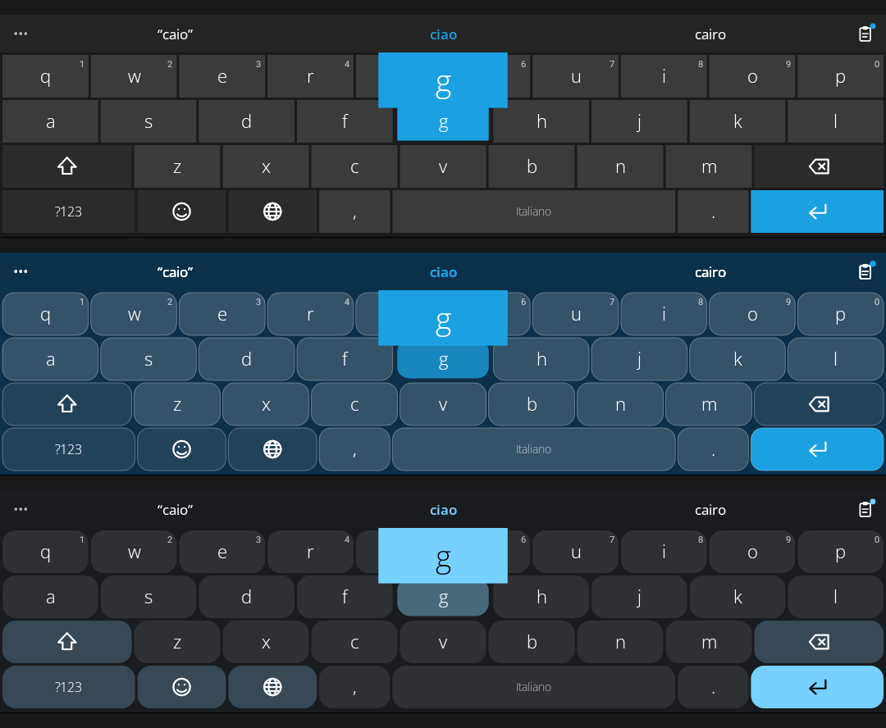

<h1 align="center">MetroWin Keyboard</h1>

<p align="center">
  <b>The Windows Phone keyboard, on Android.</b><br>
  Flat Metro keys, big light type, swipe typing, translation, GIFs, clipboard history, voice typing.<br>
  Free software. No ads, no analytics, no trackers: what you type stays on your phone.
</p>

<p align="center">
  <a href="LICENSE"></a>
  
  
</p>

<p align="center"><b>English</b> · <a href="README.it.md">Italiano</a></p>

<p align="center"></p>

Made to work together with [MetroWin Launcher](https://github.com/developerkenshi-coder/MetroWinLauncher): same three looks, same 20 colours, and it keeps out of the way in the launcher's search box. It works fine with any other launcher too.

## Install

1. Download the APK from the [latest release](../../releases/latest) and open it (allow your browser or file manager to install unknown apps).
2. Open **MetroWin Keyboard**. A guided set-up turns the keyboard on and selects it, noticing by itself when each step is done.
3. A tutorial is in the app and inside the keyboard (the three dots, then **?**).

Android 8.0 (API 26) or newer.

## Features

**Typing**
- Swipe typing, hold a key for accents, digits and symbols (hold time in ms, 200 by default), double space for a full stop, automatic capitals, slide on the space bar to move the cursor.
- A colour preview of the key you press, as on Windows Phone.
- Correction that **Backspace undoes**, accent fixing, completion, next-word and phrase prediction, offensive words blocked (plus your own list).
- Learns from you, **on the phone only**; never in password fields; exportable and erasable.

**Tools**, one tap from the bar: the three dots open the toolbox, and a **quick button** goes straight to the clipboard (or any tool you choose), with a dot when something new was copied.
- **Clipboard** history with a limit you choose, pinned items and **pictures**.
- **Translate** the field, or what you just copied (handy for messages you received), between 40 languages. Google by default; Google Cloud, DeepL, LibreTranslate or MyMemory can be chosen.
- **GIF** from a source you choose: GIPHY, Tenor (your own free key), a folder on the phone, or any JSON service you describe.
- **Emoji** and **classic emoticons** (`:-)`, kaomoji), with skin tones.
- **Voice typing**, also continuous transcription, optionally on-device only.

**Languages**: 17 layouts included (English, Italiano, Español, Français, Deutsch, Português, Nederlands, Polski, Türkçe, Русский, Українська, Ελληνικά, Čeština, Svenska, Română, العربية, עברית). Any other layout is a small text file ([docs/LAYOUTS.md](docs/LAYOUTS.md)); any dictionary can be imported (word lists, frequency lists, Hunspell `.dic`). Only small starter word lists are bundled (en, it, es, fr, de, pt), so import a full dictionary for the best predictions.

**Looks**: *Classic* (flat Windows Phone), *Modern Glass*, *Modern Droid* (Material You colours on Android 12+), dark / light / system, 20 Windows Phone colours or your own, pure black, a photo behind the keys (its colour becomes the accent), and, optionally, a keyboard that follows the colour of the app under it.

**Size**: key height (portrait and landscape), keyboard width with left / centre / right position, key spacing, number row on or off.

**Feedback**: a Windows Phone style click (synthesised, nothing of Microsoft's inside), Android's sound or your own file; vibration with adjustable strength.

## Privacy and permissions

No analytics, ads or trackers. The full list is in [PRIVACY.md](PRIVACY.md).

| Permission | Why |
| --- | --- |
| `RECORD_AUDIO` | Voice typing only; asked when you tap the microphone |
| `INTERNET` | Only for GIFs and translation, from the service you chose, when you ask |
| `VIBRATE` | Key vibration |

Backups and device transfer are disabled for the app's data. The colour service is off until you turn it on in the accessibility settings, reads no text and sends nothing.

## MetroWin Launcher

See [docs/LAUNCHER_INTEGRATION.md](docs/LAUNCHER_INTEGRATION.md): the keyboard recognises the launcher, imports its theme file and listens for a theme broadcast.

## Build from source

JDK 17 or newer and the Android SDK (platform 35).

```sh
git clone https://github.com/developerkenshi-coder/MetroWin-Keyboard.git
cd MetroWin-Keyboard
./gradlew assembleDebug          # app/build/outputs/apk/debug/app-debug.apk
./gradlew testDebugUnitTest      # engine, keyboard and tutorial tests on the JVM
./gradlew assembleRelease        # needs keystore.properties (see app/build.gradle.kts); -PsignWithDebugKey=true for a test build
```

## Contributing

Bug reports and ideas are welcome in the issue tracker, in English or Italian. See [CONTRIBUTING.md](CONTRIBUTING.md), which includes the checklist for adding a feature (and its tutorial page). Security issues: [SECURITY.md](SECURITY.md).

## License and credits

GNU General Public License v3.0 or later ([LICENSE](LICENSE)). Fonts are Open Sans (SIL Open Font License 1.1); see [THIRD_PARTY_NOTICES.md](THIRD_PARTY_NOTICES.md).

MetroWin Keyboard is an independent project. It is not affiliated with or endorsed by Microsoft or Google; Windows Phone is a trademark of Microsoft Corporation.
