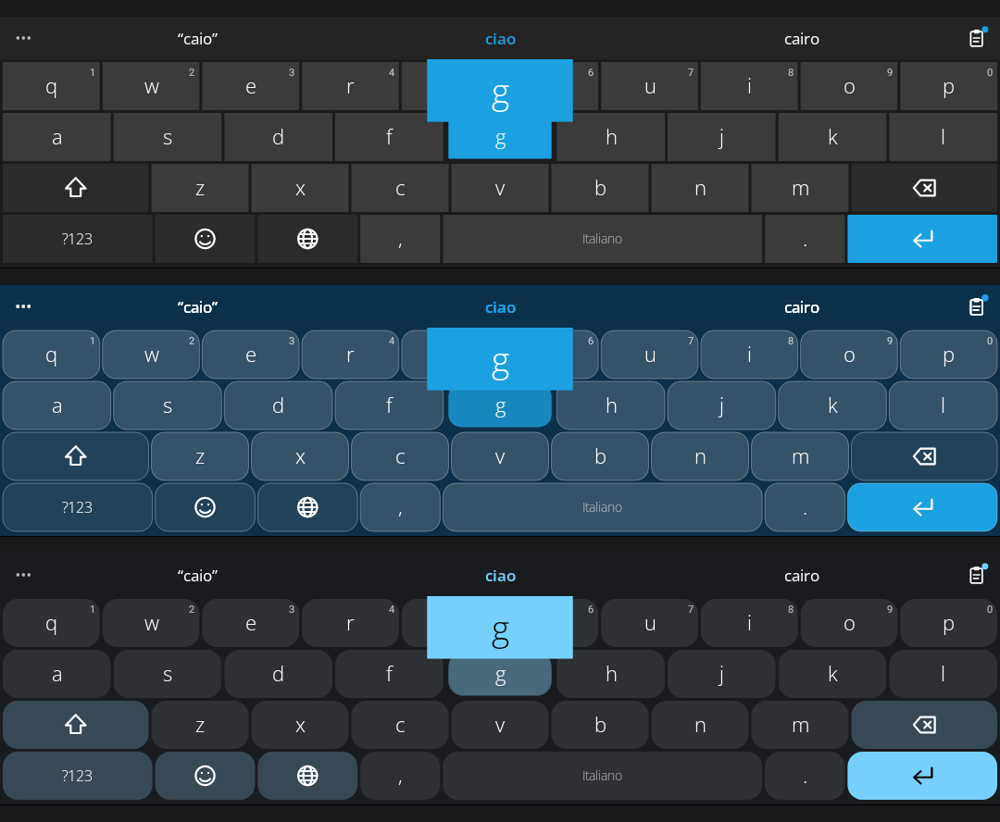

<h1 align="center">MetroWin Keyboard</h1>

<p align="center">
  <b>Android 上的 Windows Phone 键盘。</b><br>
  扁平的 Metro 按键、又大又细的字体、拼音输入、滑行输入、翻译、GIF、剪贴板历史、语音输入。<br>
  自由软件。没有广告、没有统计分析、没有跟踪器：你输入的内容留在你的手机上。
</p>

<p align="center">
  <a href="LICENSE"></a>
  <a href="https://github.com/developerkenshi-coder/MetroWin-Keyboard/releases/latest"></a>
  
</p>

<p align="center"><a href="README.md">English</a> · <a href="README.it.md">Italiano</a> · <b>简体中文</b></p>

<p align="center"></p>

为搭配 [MetroWin Launcher](https://github.com/developerkenshi-coder/MetroWinLauncher) 而设计：同样的三种风格、同样的 20 种颜色，并且在桌面的搜索框里不添乱。搭配其他任何桌面也同样好用。

## 安装

1. 从[最新版本](../../releases/latest)下载 APK 并打开（需要允许浏览器或文件管理器安装未知应用）。
2. 打开 **MetroWin Keyboard**。设置向导会带你启用并选择键盘，每一步完成后会自动识别。
3. 应用内和键盘内（三个点，然后点 **?**）都有教程。

需要 Android 8.0（API 26）或更高版本。

## 功能

**中文输入**
- 选择 **简体中文** 后用拼音输入（`ü` 用 `v`）。输入时字母留在输入框里，候选栏显示对应的字词，可左右滑动。
- 空格选第一个；点任意一个候选来选它，剩下的拼音继续选；回车直接输入字母。
- 支持整句（`wojintianhengaoxing` → 我今天很高兴）、不完整的拼音（`zhongg` → 中国）、首字母简拼（`nh` → 你好）和用撇号分隔音节（`xi'an` → 西安，撇号在长按逗号键出现的条里）。
- 逗号和句号键输入 `，` 和 `。`，符号页是中文标点，长按得到英文标点。
- 你选过的词下次排在前面，由几次选择组成的短语会被记成一个词。这些只保存在手机上，密码框中不学习，可以导出备份，也可以清除。
- 内置约 6 万个词和 GB 2312 的全部汉字。应用界面本身也有简体中文。

**输入**
- 滑行输入，长按按键输入重音字母、数字和符号（长按时间以毫秒计，默认 200），双击空格输入句号，句首自动大写，在空格键上滑动来移动光标。
- 按下按键时显示带颜色的按键预览，和 Windows Phone 一样。
- **按退格键可撤销**并会从中学习的纠错（智能：会权衡手指落点、前后的词和你撤销过的纠正；会补上漏掉的空格），重音修正、补全、下一个词和短语预测，屏蔽不雅词语（外加你自己的列表）。
- **只在手机上**向你学习；密码框中绝不学习；可导出、可清除。

**工具**，在栏上一点即达：三个点打开工具箱，**快捷按钮**直接打开剪贴板（或你选择的任何工具），有新复制的内容时会显示一个圆点。
- **剪贴板**历史，条数上限由你决定，可固定条目，支持**图片**。
- **翻译**输入框中的内容或你刚复制的内容（适合翻译收到的消息），支持 40 种语言。默认使用 Google；也可以选择 Google Cloud、DeepL、LibreTranslate 或 MyMemory。
- **GIF**，来源由你选择：GIPHY、Tenor、Klipy 或 Imgur（使用你自己的免费密钥；有按钮打开获取页面）、手机上的文件夹，或你描述的任何 JSON 服务，内容分级从 G 到 R。
- **表情**和**经典颜文字**（`:-)`、日式颜文字），支持肤色。
- **语音输入**，也支持连续转写，可选择仅在本机识别。

**校准**：其他键盘都没有的功能。输入几句话，键盘就能学到*你的*手指落在哪里（偏移、拇指的弧线、点击的分散程度），在不移动按键的情况下修正你的触摸，如果仍然按偏就把按键加高或把间距缩小，并在一句和下一句之间让修正生效，所以你能看到它在变好。在你点“应用”之前不会保留任何内容。

**智能纠错**：一个在手机上运行的小模型，根据手指落点、键盘上每种失误的可能性、词的常用程度、前一个词以及你撤销过的纠正来修正拼写错误。两种修正同样可能时会都显示出来，而不直接应用。

**备份**：一个文件包含应用保存的一切（设置、学到的词、词库、剪贴板）；可在另一部手机上或用另一个签名重新安装后恢复。

**语言**：内置 18 种布局（English、Italiano、Español、Français、Deutsch、Português、Nederlands、Polski、Türkçe、Русский、Українська、Ελληνικά、Čeština、Svenska、Română、العربية、עברית、简体中文）。其他任何布局都只是一个小文本文件（[docs/LAYOUTS.md](docs/LAYOUTS.md)）；可以导入任何词库（词表、词频表、Hunspell `.dic`）。

**外观**：*经典*（扁平 Windows Phone）、*Modern Glass*、*Modern Droid*（Android 12+ 上使用 Material You 颜色），深色 / 浅色 / 跟随系统，20 种 Windows Phone 颜色或自定义颜色，纯黑，按键后面放照片（照片的颜色成为主题色），还可以让键盘跟随下方应用的颜色。

**与 Windows Phone 一致的细节**：所有字母键等宽，第二行字母向内缩进半个键；数字符号键是 `&123`，返回字母是 `abcd`；符号页按 Windows Phone 的顺序排列；语言键用三个字母显示当前语言（`ENU`、`ITA`、`CHS`…）。

**大小**：实时预览，按键高度（竖屏和横屏）、键盘宽度及靠左 / 居中 / 靠右、按键间距、数字行开关，以及自动校准。

**反馈**：Windows Phone 风格的按键音（合成的，不含任何 Microsoft 的素材）、Android 自带的声音或你自己的文件；强度可调的振动。

## 隐私和权限

没有统计分析、广告或跟踪器。完整说明见 [PRIVACY.md](PRIVACY.md)。

| 权限 | 用途 |
| --- | --- |
| `RECORD_AUDIO` | 仅用于语音输入；在你点击麦克风时才请求 |
| `INTERNET` | 仅用于 GIF 和翻译（在你要求时，访问你选择的服务），以及每 12 小时到本键盘在 GitHub 上的仓库检查更新（可关闭） |
| `REQUEST_INSTALL_PACKAGES` | 仅用于为你在 *设置 → 更新* 中选择下载的新版本打开安装程序 |
| `RECEIVE_BOOT_COMPLETED` | 重启后保持每 12 小时的更新检查 |
| `VIBRATE` | 按键振动 |

应用数据不参与系统备份和设备迁移。取色服务在你到无障碍设置中开启之前一直是关闭的，它不读取文字，也不发送任何内容。

## 从源码构建

需要 JDK 17 或更高版本和 Android SDK（平台 35）。

```sh
git clone https://github.com/developerkenshi-coder/MetroWin-Keyboard.git
cd MetroWin-Keyboard
./gradlew assembleDebug          # app/build/outputs/apk/debug/app-debug.apk
./gradlew testDebugUnitTest      # 在 JVM 上运行引擎、键盘和教程的测试
./gradlew assembleRelease        # 需要 keystore.properties（见 app/build.gradle.kts）；测试构建可加 -PsignWithDebugKey=true
```

中文词库由 `tools/build_pinyin.py` 生成（`pip install jieba pypinyin`）。

## 参与贡献

欢迎在 issue 中用英语或意大利语提交错误报告和想法。请参阅 [CONTRIBUTING.md](CONTRIBUTING.md)。安全问题见 [SECURITY.md](SECURITY.md)。

## 许可证和致谢

GNU 通用公共许可证 v3.0 或更高版本（[LICENSE](LICENSE)）。字体为 Open Sans（SIL Open Font License 1.1）；中文词库来自 jieba 和 pypinyin（均为 MIT）。详见 [THIRD_PARTY_NOTICES.md](THIRD_PARTY_NOTICES.md)。

MetroWin Keyboard 是一个独立项目，与 Microsoft 或 Google 没有关联，也未获其认可；Windows Phone 是 Microsoft Corporation 的商标。
