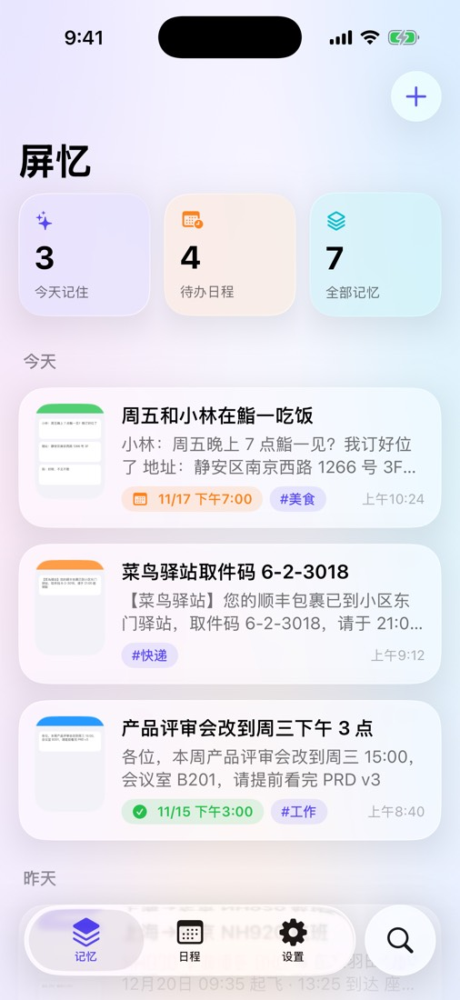
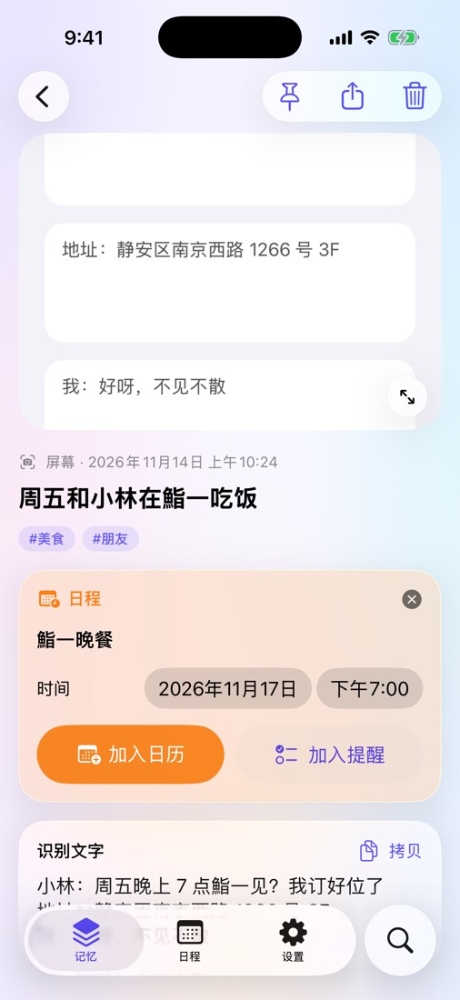
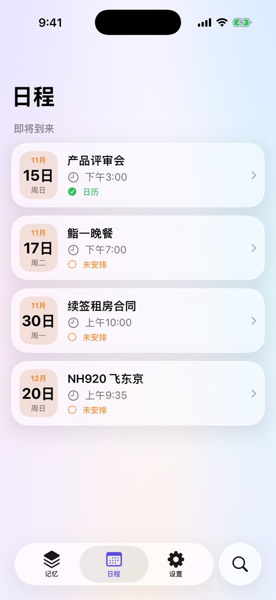
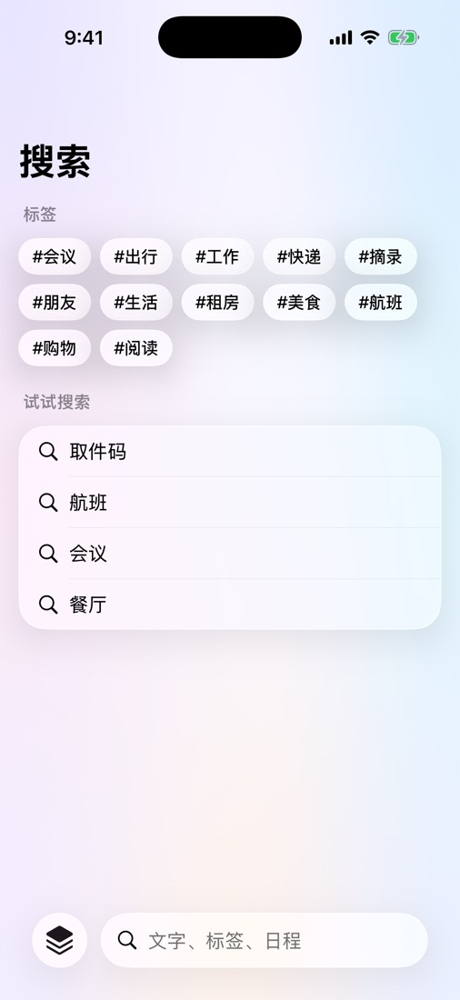
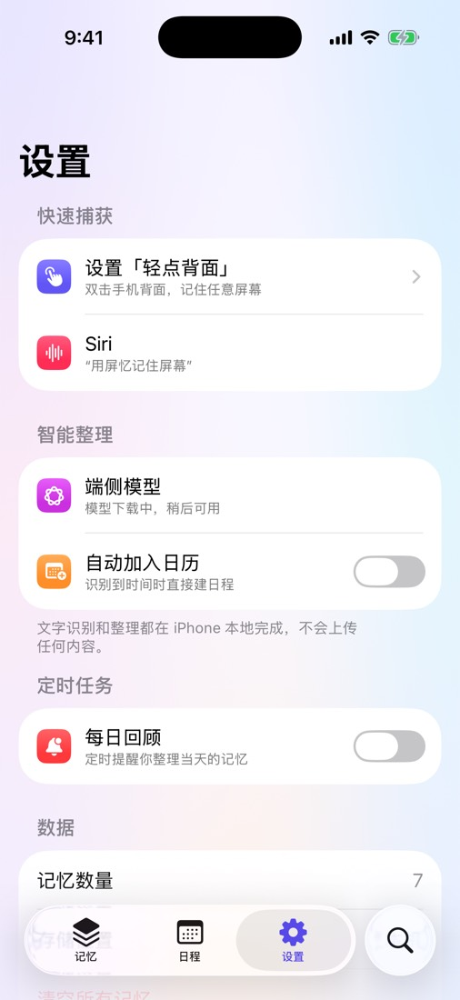
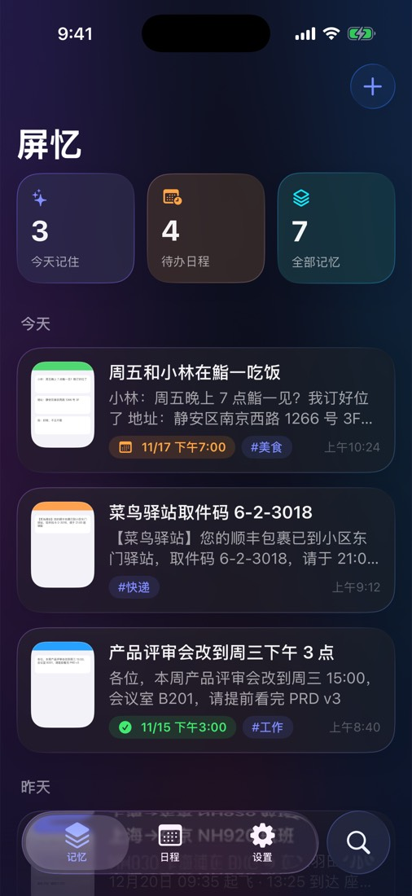
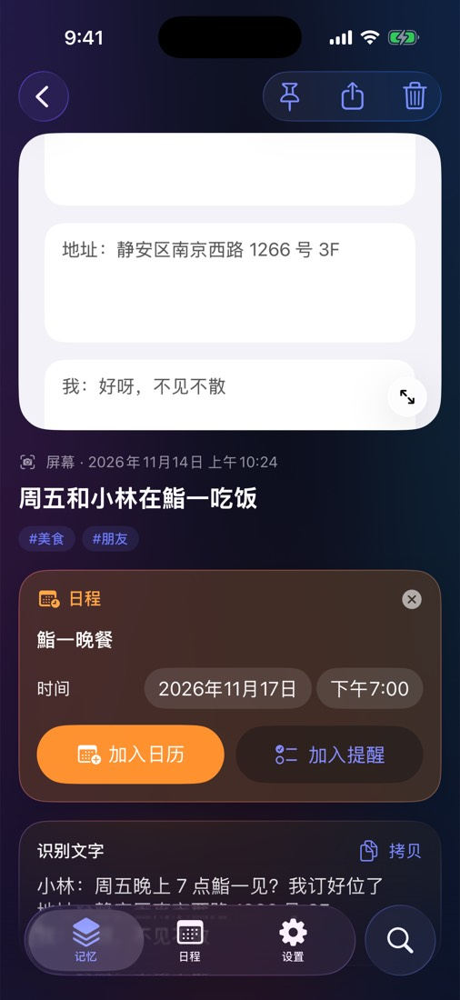
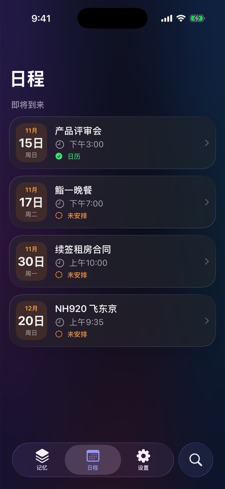
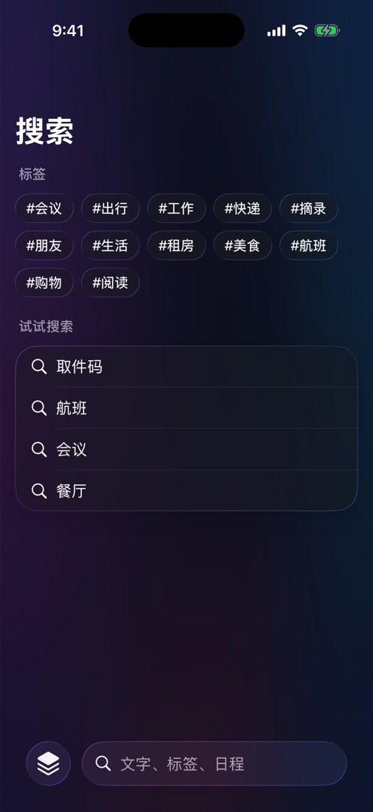
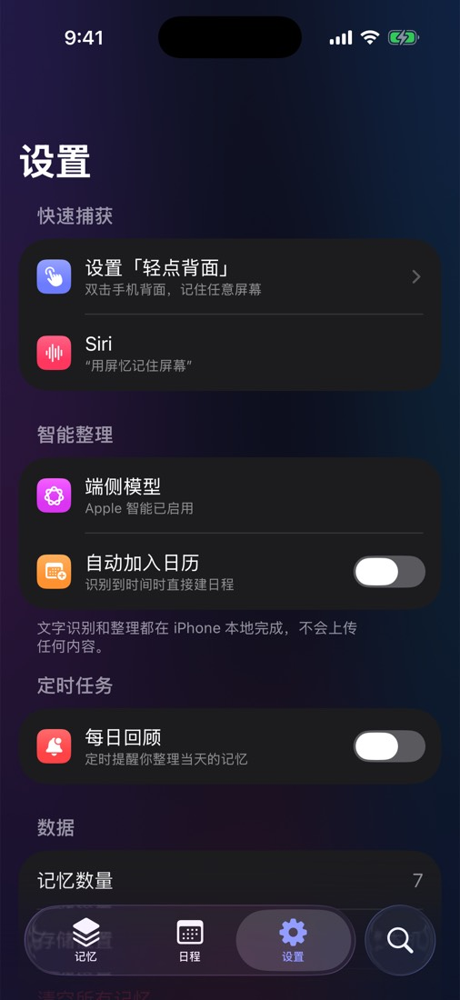

# 屏忆：一键记住 iPhone 屏幕

在任何 App 里**双击手机背面**，屏忆就会截下当前屏幕，在本地识别文字、整理成一条记忆。如果屏幕上有时间或约定，它会提取成日程，可以一键加入日历或提醒事项。

| 记忆 | 详情 | 日程 | 搜索 | 设置 |
|---|---|---|---|---|
|  |  |  |  |  |
|  |  |  |  |  |

## 功能

- **随时捕获**：轻点背面、操作按钮、控制中心、Siri，或在 App 内从相册、剪贴板导入，也可以直接写一条
- **本地理解**：Vision 识别中英文文字；在支持 Apple 智能的设备上，用端侧模型生成摘要、标签并提取事件；其他设备用系统的日期识别作为降级方案
- **记忆库**：按天排列的时间线，支持置顶、全文搜索、标签筛选，也能在系统 Spotlight 里搜到
- **日程**：提取出的事件集中显示，一键加入日历（提前 15 分钟提醒）或提醒事项；可开启"识别到时间自动加入日历"
- **定时任务**：每日回顾通知
- **隐私**：所有内容只保存在本机，不联网、不上传
- **界面**：iOS 26 液态玻璃（Liquid Glass），支持深色模式

需要 iOS 26 或更高版本。

## 安装 IPA

1. 打开仓库的 **Actions → iOS build**，进入最新一次成功的运行，下载 `Pingyi-ipa` 并解压，得到 `Pingyi.ipa`
2. 这个 IPA **没有签名**，需要用自己的 Apple ID 重新签名后安装，任选一种方式：
   - **Sideloadly**（Windows/Mac）：连接 iPhone，拖入 IPA，登录 Apple ID 后点击 Start
   - **AltStore**：在 AltStore 中选择 IPA 安装
   - 有付费开发者账号的话，用 Xcode 或 `xcodebuild` 正式签名
3. iPhone 上进入 设置 › 通用 › VPN 与设备管理，信任你的开发者证书；iOS 16 及以上还需要在 设置 › 隐私与安全性 里打开"开发者模式"

> 用免费 Apple ID 签名的 App 每 7 天需要重新签名一次（AltStore 可以自动续签）。

## 设置「轻点背面」

1. 打开「快捷指令」，新建一个快捷指令，命名为「记住屏幕」
2. 添加动作「截屏」
3. 添加动作「记住屏幕」（屏忆），截图参数选择上一步的「截屏」
4. 打开 设置 › 辅助功能 › 触控 › 轻点背面 › 轻点两下，选择「记住屏幕」

App 内 设置 › 设置「轻点背面」 也有图文说明。

## 自己构建

```bash
cd iphone-memory/app
brew install xcodegen && xcodegen generate
open Pingyi.xcodeproj          # Xcode 26+
```

每次推送到分支都会触发 `.github/workflows/ios.yml`：在 macOS 云端运行器上构建未签名 IPA，在模拟器里截图，并把截图提交回 `iphone-memory/screenshots/`。

## 代码结构

```
app/Pingyi/
├── App/        入口、全局状态、模拟器演示数据
├── Model/      SwiftData 记忆模型
├── Services/   OCR、提取（Foundation Models + 降级）、日历/提醒/通知、Spotlight
├── Intents/    App Intents：记住屏幕 / 记一条文字 / 搜索记忆
└── Views/      时间线、详情、日程、搜索、设置、引导（液态玻璃）
```
