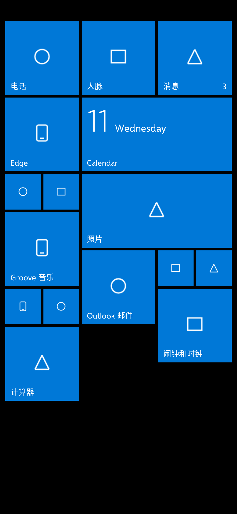
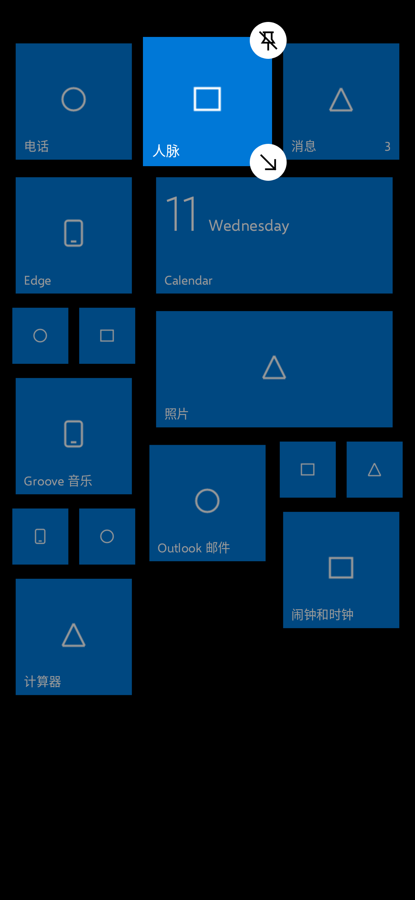

# Win10M Launcher —— 安卓上的 Windows 10 Mobile 开始屏幕

在 Android 上按 1:1 规格复刻 Windows 10 Mobile 原生开始屏幕（启动器 / Home app）。

先收集资料，再写代码：所有尺寸、字号、颜色、动画参数见 [`research/W10M_START_SPEC.md`](research/W10M_START_SPEC.md)，
每个数值都标了来源（官方文档 / 推导 / 真机截图实测）。W10M 的逻辑宽度为 360 epx，正好对应 Android 的 360 dp，因此 1 epx = 1 dp。

## 已实现
| 模块 | 内容 |
|---|---|
| 开始屏幕 | 6 列（或「显示更多磁贴」8 列）小磁贴网格，间距 4、边距 8；小/中/宽三种尺寸，按顺序首次适配排列，中/宽磁贴对齐偶数列 |
| 磁贴 | 主题色直角磁贴，左下 12sp 名称，右下通知角标；Android 13+ 单色图标渲染为白色字形 |
| 动态磁贴 | 日历磁贴（日期大数字 + 星期 / 背面时间），6~10 秒随机 X 轴翻转 |
| 交互动画 | 按下 3D 倾斜（Tilt）、打开应用 Turnstile 飞出、返回时 Turnstile 飞入 |
| 编辑模式 | 长按：其他磁贴缩小到 0.9 并变暗，右上「取消固定」、右下「调整大小」圆形按钮，拖动重新排序 |
| 所有应用 | 左滑进入；搜索框、「最近添加」、按字母分组（中文按拼音首字母，ICU AlphabeticIndex），点字母打开 4 列跳转网格；长按弹出 W10M 菜单（固定到开始屏幕 / 应用信息 / 卸载） |
| 设置 | 深色/浅色、48 色主题色、背景（纯色 / 图片在磁贴后面 / 图片显示在磁贴上 + 视差）、磁贴透明度、显示更多磁贴、角标权限、设为默认桌面 |

## 截图（Robolectric 离屏渲染，1080×2340）
| 开始屏幕 | 编辑模式 | 所有应用 |
|---|---|---|
|  |  |  |

截图中磁贴的图标是测试用占位图形，真机上显示的是各应用自己的图标。

## 构建
```bash
./gradlew assembleDebug           # 输出 app/build/outputs/apk/debug/app-debug.apk
./gradlew testDebugUnitTest       # 排列算法单元测试 + 截图测试（输出 app/build/screens/）
```
安装后在系统设置里把「开始」设为默认桌面；应用列表里的「开始屏幕设置」是设置入口（也可以长按开始屏幕空白处）。

## 版权说明
- 字体：Segoe UI 不能随应用分发，这里改用微软以 SIL OFL 1.1 开源的 **Selawik**（与 Segoe UI 度量兼容），许可证见 `research/SELAWIK-LICENSE.txt`。
- 图标：没有使用 Segoe MDL2 Assets 和任何微软标志，系统图标都是自绘矢量。
